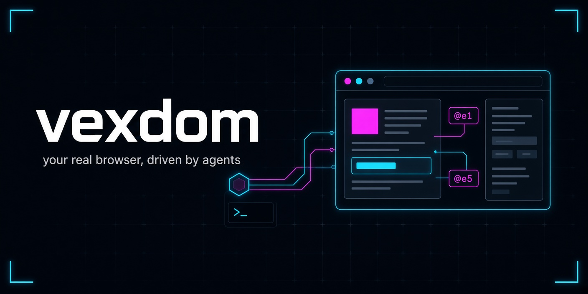
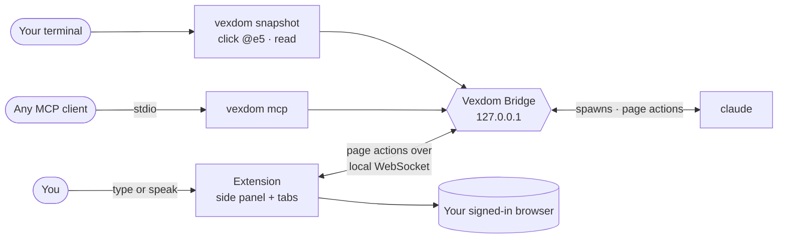

<p align="center">
  
</p>

# vexdom

Your real, signed-in browser, driven by an agent: from a side panel running Claude Code, from the
`vexdom` CLI, or from any MCP client. Page snapshots are made for agents (compact, ref-addressed and
incremental), so a task costs fewer tokens.

One Rust binary, `vexdom`, is the Bridge the browser extension connects to, the command line and
an MCP server. The extension acts on your tabs and hosts the side panel. Everything binds to
`127.0.0.1`: no account, no cloud, no telemetry.



## Install

macOS (Apple silicon, Intel) or Linux with glibc (x64, arm64):

```sh
curl -fsSL https://github.com/nguyenthdat/vexdom/releases/latest/download/install.sh | sh
vexdom setup
```

The script installs `vexdom` into `~/.local/share/vexdom` and, on macOS, `Vexdom.app`. `vexdom
setup` adds the extension to your browser (Chrome, Edge, Brave, Arc, Vivaldi, Opera, Chromium, or
Firefox 140+) and pairs it. Details: [Install](docs/guide/install.md), [Pair](docs/guide/pair.md),
[First run](docs/guide/first-run.md).

## Use it

- **Side panel:** type or dictate an instruction; it runs through
  [Claude Code](https://claude.com/claude-code), which must be on your `PATH` and signed in.
- **MCP:** `claude mcp add vexdom -- vexdom mcp`, or any client that speaks stdio
  ([MCP clients](docs/guide/mcp-clients.md)).
- **CLI:** `vexdom snapshot`, `vexdom click @e5`, `vexdom read`; `vexdom skills get core` explains
  the snapshot → ref → action loop. `vexdom doctor` diagnoses a broken setup.

Every capability has its own page under [docs/guide/features](docs/guide/features/).

## Build from source

Requirements: Bun 1.4.5, Rust (the toolchain in `rust-toolchain.toml`, with the
`wasm32-unknown-unknown` target), `cargo install boltffi_cli --version 0.32.1`, binaryen's
`wasm-opt` and `capnp`.

```sh
cd packages/extension
bun install
bun run build                         # extension → dist/chrome-mv3 (build:firefox for Firefox)
bun run bridge:build                  # Bridge, CLI and MCP server → target/release/vexdom
../../target/release/vexdom setup --unpacked
```

Check before a pull request (Rust fmt, clippy and tests, type check, tests with coverage):

```sh
cd packages/extension && bun run check
```

See [CONTRIBUTING.md](CONTRIBUTING.md).

## Repository

| Path | What it holds |
| --- | --- |
| `app/` | The `vexdom` binary: Bridge, CLI, MCP server |
| `crates/` | The Bridge's libraries (`vexdom-*`) and `ext-core`, compiled to wasm for the extension |
| `packages/extension/` | The browser extension (WXT, TypeScript) |
| `desktop/` | `Vexdom.app`, the macOS desktop app (GPUI) |
| `docs/` | [User guide](docs/guide/), [internals](docs/internals/), [reference](docs/reference/), [research](docs/research/) |

Architecture decisions are in [docs/internals/decisions.md](docs/internals/decisions.md).

## Credits

vexdom is a fork of [Browsentic](https://github.com/imshaikot/browsentic) (Apache-2.0) and borrows
the snapshot-and-ref approach of Vercel's [agent-browser](https://github.com/vercel-labs/agent-browser).

## License

Apache License 2.0. See [LICENSE](LICENSE) and [NOTICE](NOTICE).
