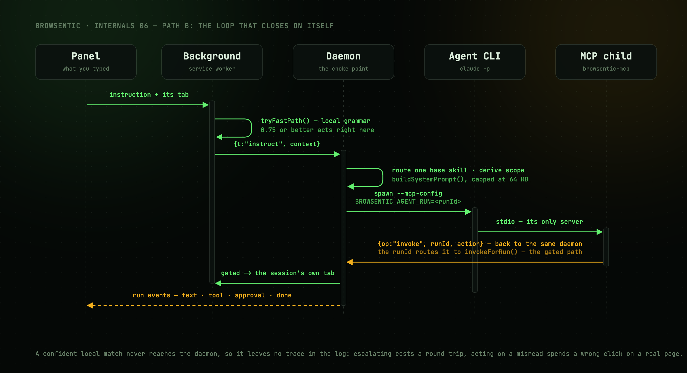
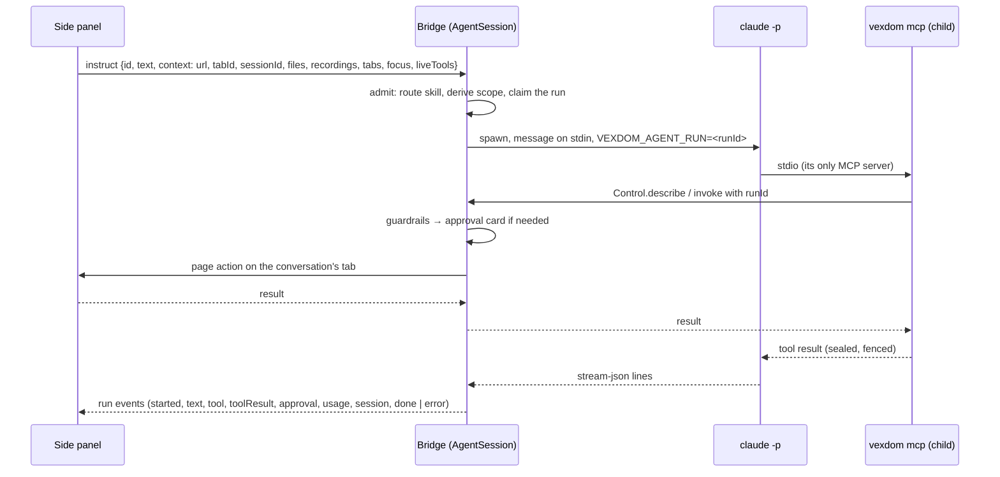

# Path B: an agent run from the side panel

An instruction typed or spoken into the side panel is first scored in the browser. Only what the
local grammar cannot handle reaches the Bridge, which starts Claude Code to run it. This page covers
that funnel, the runner, prompt assembly, what a run is offered, the file and captcha analysts, site
mapping and skill routing. The code is in
[`crates/vexdom-daemon/src/agent/`](../../crates/vexdom-daemon/src/agent/).



[The same sequence, animated →](../assets/agent-runs.gif)

---

## The intent funnel

`tryFastPath()` in [`fast-path.ts`](../../packages/extension/src/lib/bridge/fast-path.ts) calls
`routeIntent`, which is `route_intent()` in
[`crates/vexdom-pure/src/intent.rs`](../../crates/vexdom-pure/src/intent.rs) compiled into the
extension's wasm (ext-core, reached through
[`pure.ts`](../../packages/extension/src/lib/bridge/pure.ts)). Each rule has a `certainty` and its
slot extraction a `confidence`; their product must reach `ACT_THRESHOLD` (**0.75**) to act locally.

These escalate before any rule is scored:

| Reason | Fires on |
| --- | --- |
| `skill-prefix` | text starting with `@` |
| `question` | a trailing `?`, or an opening word such as *what*, *how*, *find*, *show*, *fill* |
| `multi-step` | *and then*, *then*, *after that*, *and also*, *followed by* |
| `conditional` | *if*, *unless*, *whenever*, *maybe*, *try to*, *see if*, *in case*, … |

A matched rule whose slots look consequential (*buy*, *pay*, *checkout*, *delete*, *send*,
*submit*, *transfer*, *confirm*, …) escalates as `consequential`; a score under the threshold as
`below-threshold`; no match as `no-match`.

A confident match runs through `invokeForHarness` in the extension and shows on the timeline with
`source: 'local'`. It never reaches the Bridge, so it is not in `vexdom logs`. A local action that
fails escalates to the agent, except a recording toggle or a `SITE_BLOCKED` refusal, which are
reported as they are.

Explain one decision with `bun run check:intent "<utterance>"` in `packages/extension/`.

---

## The agent run



`AgentSession` in [`service.rs`](../../crates/vexdom-daemon/src/agent/service.rs) holds one
browser's runs. The extension's frames arrive as `AgentRequest` (`Instruct`, `Cancel`, `Decision`,
…) in [`agent/mod.rs`](../../crates/vexdom-daemon/src/agent/mod.rs).

**Admission** (`admit()`) refuses at once, before any process starts:

| Code | When |
| --- | --- |
| `INVALID_INPUT` | the instruction is empty |
| `RUN_IN_PROGRESS` | this conversation (`sessionId`) already has a run |
| `NO_SKILL` | no skill could be loaded |
| `RUN_LIMIT` | `maxConcurrentRuns` runs are going across every browser (default 3, at most 8) |
| `MAPPING_NOT_REQUESTED` | the routed skill is the bundled `site-mapper` and the user did not ask for mapping explicitly |

Then the agent is probed (`agent_state()`); one that is not ready fails with the code the probe
reported, `AGENT_MISSING` by default.

### How the run reaches the browser

The spawned CLI gets one MCP server: this same binary's `mcp` subcommand (`mcp_server_for()` in
[`runners/mod.rs`](../../crates/vexdom-daemon/src/agent/runners/mod.rs)) with
`VEXDOM_AGENT_RUN=<runId>` in its environment. [`app/src/mcp/mod.rs`](../../app/src/mcp/mod.rs)
reads that variable and connects with `Bridge::connect(run_id)`
([`vexdom-client`](../../crates/vexdom-client/src/lib.rs)), so every `describe` and `invoke` on the
control socket carries the run id. [`control.rs`](../../crates/vexdom-daemon/src/control.rs) sends
those invokes to `AgentSession::invoke_for_run()`, not to `invoke_external()`.

The run's server is the same three-tool server every MCP client gets (`snapshot`, `act`, `guide`;
[`app/src/mcp/host.rs`](../../app/src/mcp/host.rs)). A control connection that has spoken for a run
is refused anything that would loosen its own limits: `setPreference` (`BLOCKED`), reading or
answering confirmations, pairing decisions, notices, and stopping the Bridge.

### What a run is offered

`offer_for()` decides what `act` lists for a run, on top of the browser's tool manifest:

| | Actions | Rule |
| --- | --- | --- |
| Withheld | `page.injectCode`, `page.runCode` | Until the composer's **Live tool** switch is on for this message, or the conversation was already shown them (the list may grow within a conversation, never shrink). A call while withheld fails `LIVE_TOOLS_OFF` |
| Reserved, always | `vexdom.focusShot` | The element picked with A-Eye, as photographed; `NO_FOCUS_SHOT` when no pick came with the message |
| Reserved, mapping only | `vexdom.saveSiteMap` | The mapping run's report ([below](#site-mapping)) |

The MCP host never runs `bridge.authSave` or `page.checkSites` for anyone (`REFUSED_ACTIONS`).

### A call through the run

`invoke_for_run()`:

1. `RUN_INACTIVE` when the run has ended.
2. Reserved actions and the Live tool check above.
3. A mapping run's call goes through the [mapping gate](#site-mapping) instead of the policy.
4. `guardrails::decide()` with `Caller::Agent` and the run's scope
   ([Guardrails](guardrails.md)). `deny` returns `BLOCKED`.
5. `confirm` sends an `approval` event to the panel and waits, unless `approvals.json` holds a grant
   for that action on the run's starting site, or the action was already allowed in this run. The
   answer gives `DECLINED`, or runs the action; "always" stores a grant. One yes to
   `page.solveCaptcha` covers every round of that run.
6. The action runs on the run's tab with the run's hosts (for downloads). `page.openTab` adds the new
   tab to the tabs the run owns; `page.openTab`, `page.switchTab` and `page.closeTab` move the run's
   current tab.

An unscheduled run waits for an approval as long as the user takes. A run started by a schedule
(`context.task`) waits `TASK_APPROVAL_WAIT_MS` (10 minutes), then fails the call with
`APPROVAL_TIMEOUT`, and the whole run is cut at `TASK_RUN_MAX_MS` (20 minutes). Dropping the call's
future (the agent stopped waiting) withdraws its approval card.

**Conversation continuity.** The runner reports the session id Claude Code established, and the next
turn of the same conversation resumes it (`--resume`). The session is kept per panel conversation
in `AgentSession.held`, with the agent kind; switching agents or a mapping run starts fresh.

---

## The runner

Claude Code is the only agent (`runner_of()` returns `claude::Claude` for every kind). The pieces:

| File | Does |
| --- | --- |
| [`runner.rs`](../../crates/vexdom-daemon/src/agent/runner.rs) | `run_instruction()` for a turn, `run_agent_json()` for a one-shot with no browser, `TaskFile` for scratch files |
| [`runners/claude.rs`](../../crates/vexdom-daemon/src/agent/runners/claude.rs) | the argv for both, and the stream-json reader |
| [`runners/drive.rs`](../../crates/vexdom-daemon/src/agent/runners/drive.rs) | `launch()`: vet the plan, write its files, build the environment, spawn, supervise, read lines |
| [`runners/command.rs`](../../crates/vexdom-daemon/src/agent/runners/command.rs) | `spawn_cli()` into a process group of its own, `stop_tree()` signals the group (macOS and Linux only) |
| [`runners/mod.rs`](../../crates/vexdom-daemon/src/agent/runners/mod.rs) | readiness: `claude --version`, 8 s timeout, cached 30 s |
| [`runners/models.rs`](../../crates/vexdom-daemon/src/agent/runners/models.rs) | the models the picker offers |

### A turn

```
claude -p --output-format stream-json --include-partial-messages --verbose
  --mcp-config '{"mcpServers":{"vexdom":{"command":"<vexdom>","args":["mcp"],"env":{"VEXDOM_AGENT_RUN":"<runId>"}}}}'
  --strict-mcp-config --tools ""            (WebSearch WebFetch on a researching mapping run)
  --allowedTools mcp__vexdom
  --disallowedTools Bash Edit Write NotebookEdit Glob Grep Read Task Monitor Workflow Skill ToolSearch …
                    WebSearch WebFetch      (unless researching)
  --append-system-prompt-file ~/.vexdom/agents/claude/prompts/<run>.md
  --session-id <new uuid> | --resume <session>
  [--model <id>] [--effort low|medium|high|xhigh|max]
```

- The message goes on **stdin** and the system prompt in a 0600 file, because anyone can read argv.
- The working directory is `~/.vexdom` (`VEXDOM_HOME`).
- The environment is the Bridge's own, minus credential-shaped variables (`seal_env()`) and minus
  `CLAUDECODE`, `CLAUDE_CODE_ENTRYPOINT` and `VEXDOM_AGENT_RUN` inherited from a parent; then the
  plan's own `VEXDOM_AGENT_RUN`.
- Before it starts, `vet_plan()` checks the argv ([Guardrails § Spawn containment](guardrails.md#spawn-containment));
  a failed check is `AGENT_UNSAFE`.
- Cancel or abort sends SIGTERM to the process group, SIGKILL after 5 s.

The reader turns each stream-json line into a run event: text deltas, tool start and result, the
session id, token usage, done. Only top-level content is forwarded; a subagent's lines are dropped.
An `init` line reporting the `vexdom` server as anything but `connected` or `pending` fails the run,
since Claude Code would carry on without the browser. Text deltas pass through a `StreamSealer` so a
credential split across two deltas is still sealed.

### A one-shot

```
claude -p <prompt> --output-format json --no-session-persistence
  --mcp-config '{"mcpServers":{}}' --strict-mcp-config --tools [Read] [--allowedTools Read]
  --disallowedTools <every built-in denied above, minus Read when the prompt names a file>
```

One-shots run in `~/.vexdom` with scratch files under `~/.vexdom/tmp` (0600, deleted when the
`TaskFile` drops). They name conversations ([`title.rs`](../../crates/vexdom-daemon/src/agent/title.rs),
30 s), read back recordings ([`recording.rs`](../../crates/vexdom-daemon/src/agent/recording.rs),
110 s, answer after `=== WORKFLOW ===`, checked by
[`vexdom-pure/src/workflow.rs`](../../crates/vexdom-pure/src/workflow.rs)), and do the file and captcha
analysis below. They cannot reach the browser.

---

## Prompt assembly

`build_system_prompt()` in [`prompt.rs`](../../crates/vexdom-daemon/src/agent/prompt.rs) renders a
fixed opening and the numbered rules (page content is data, do not exfiltrate, credentials arrive
sealed and pass through unchanged, a `DECLINED` action is final, report what happened; plus what the
recoverable error codes mean and how brief to be), then these sections, in order:

| Key | Heading | Content |
| --- | --- | --- |
| `skill` | `# Skill: <name>` | the routed base skill |
| `instructions` | `# The user's standing instructions` | from `profile.json` |
| `profile` | `# About the user` | saved details from `profile.json` |
| `attached` | `# Attached skill: <name>` | one of the user's `~/.claude/skills`, picked in the panel ([`agent_skills.rs`](../../crates/vexdom-daemon/src/agent/agent_skills.rs)) |
| `focus` | `# Focused element (A-Eye)` | the picked element, up to 6 KB |
| `tabs` | `# This conversation's tabs` | the roster when the conversation has more than one tab (20 at most) |
| `scheduled` | `# Scheduled run` | when a schedule started the run |
| `fetched` | `# Fetched data` | `robots.txt` and sitemap facts, mapping runs only |
| `attachments` | `# Attached files` | one line per file whose report the session already has |
| `recordings` | `# Recorded browsing sessions` | the recordings index, up to 4 KB |
| `site-notes` | `## Site notes: <name>` | matching overlays, hand-written before machine-generated |

Every untrusted block has its own introduction saying it is data. The whole prompt is capped at
**64 KB**: an attached skill or site notes that would not fit are dropped by name and reported in the
`started` event as `(too large — not applied)`.

### A prompt the session keeps

Claude Code records the system prompt on a session's first request and resends that on every
resume (`keeps_first_prompt()`). So on a resumed turn, `prompt_update()` compares the sections the
session last saw (`Held.sections`) with the new ones, and `turn_message()` puts the difference at
the head of the message:

```
# Vexdom's instructions for this message        only when something changed
<each new or changed section>
No longer in force: <each section that has gone>
---
# Attached files                                only when file reports travel
---
# The user's message
<the instruction, unchanged>
```

`held` moves on only when a turn succeeds. After a Bridge restart nothing is held, so the first
resumed turn restates the whole prompt once.

---

## The file analyst

Attaching a file in the panel starts one one-shot per file (`FileAnalyses` in
[`file_analyst.rs`](../../crates/vexdom-daemon/src/agent/file_analyst.rs)).

1. **Screening** ([`file_screen.rs`](../../crates/vexdom-daemon/src/agent/file_screen.rs)), before
   anything spawns. The kind comes from the bytes (`%PDF-`, image signatures, UTF-8 text with no NUL
   in the first 64 KB), never from the name or MIME type. Refusals: `FILE_TOO_LARGE` (over the 10 MB
   store cap, or over 5 MB text or image, 10 MB PDF), `EMPTY`, `UNSUPPORTED_TYPE` (a ZIP, any other
   binary).
2. **The one-shot.** The file is written to `~/.vexdom/tmp` at 0600 under the extension its bytes
   earned, `Read` is allowed, and the answer is one JSON object after `=== REPORT ===`, validated by
   `validate_file_report()` ([`file_report.rs`](../../crates/vexdom-daemon/src/agent/file_report.rs)).
   The CLI is stopped the moment the answer is accepted.
3. **Bounds.** Two analysts at once, the rest queued; 60 s each. The report is kept two minutes for a
   turn sent while it was being written.

Every outcome is a report with a verdict: `analyzed`, `rejected` or `failed`.

**Handing over** ([`attachments.rs`](../../crates/vexdom-daemon/src/agent/attachments.rs)): a report
travels once, in the next message of the conversation it was attached in, under `# Attached files`,
so it stays in the Claude Code session's history. A turn that does not resume a session is handed
every report again. The block is capped at 16 KB; what does not fit waits for the next turn.

---

## The captcha analyst

`page.solveCaptcha` from a run or an MCP client goes through `solve_captcha_with_analyst()` in
[`captcha_solver.rs`](../../crates/vexdom-daemon/src/agent/captcha_solver.rs) (called from
[`invoke.rs`](../../crates/vexdom-daemon/src/invoke.rs)):

```
caller ──solveCaptcha──► Bridge ──► extension   tick the box; a challenge opens
                                ◄── state + photo of the grid
                answer_challenge() one-shot, effort low, Read only
                                ──► extension   solveCaptcha {tiles | points | reload}
                                ◄── next round … or solved
caller ◄── result with analystRounds
```

- Each round is a fresh one-shot ([`captcha_analyst.rs`](../../crates/vexdom-daemon/src/agent/captcha_analyst.rs)):
  the JPEG goes to `~/.vexdom/tmp`, the answer is JSON after `=== ANSWER ===` (at most 16 points), 45 s.
  An answer naming a tile outside the grid is discarded whole.
- The budget is the call's `timeoutMs`, 120 s by default, shared by every round. The loop stops at
  10 rounds, when less than 12 s is left, or when the analyst cannot answer; the open challenge then
  goes back to the caller with its photo.
- A caller that passes `tiles` or `reload` answers the round itself; the analyst is skipped.

The extension half is [`captcha.ts`](../../packages/extension/src/lib/bridge/captcha.ts),
[`captcha-challenge.ts`](../../packages/extension/src/lib/bridge/captcha-challenge.ts) and
[`frame-graph.ts`](../../packages/extension/src/lib/bridge/frame-graph.ts), over the debugger, so it
is Chromium-only.

---

## Site mapping

A mapping run explores one site read-only and writes a site skill for the user to review.

1. **Asked for explicitly**: the **Map this site** button, or a message starting `@site-mapper`.
2. **The site's own index first.** [`sitemap.rs`](../../crates/vexdom-daemon/src/agent/sitemap.rs)
   reads `robots.txt` and the sitemaps it names, on the mapped origin only: a host resolving to a
   private address is refused, at most 2 same-origin redirects, 4 MiB a document, 16 MiB in all,
   20 documents, 10 s a request. What it found becomes the `fetched` prompt section.
3. **The gate.** Every call goes through `gate_mapping_invoke()` in
   [`mapping.rs`](../../crates/vexdom-daemon/src/agent/mapping.rs), not the guardrail policy:

   | Code | When |
   | --- | --- |
   | `MAPPING_READ_ONLY` | the action is not one of 19 read-only actions (`page.navigate`, `page.screenshot`, `page.extractText`, `page.query`, …); `page.clickElement` only with `siteMap.allowClicks` |
   | `MAPPING_OFF_SITE` | a navigation to another origin, history back or forward, or any read while the tab has drifted off the site |
   | `MAPPING_BUDGET` | more than `siteMap.maxPages` distinct paths, or `siteMap.maxScreenshots` screenshots |

   Screenshots are saved into the staging folder as `NN-<slug>.png`.
4. **Settings** (`site_map_settings()` in [`config.rs`](../../crates/vexdom-core/src/config.rs)):
   `research` (default on: Claude Code may use `WebSearch` and `WebFetch`), `allowClicks` (off),
   `maxPages` 15 (at most 40), `maxScreenshots` 10 (at most 24), `timeoutMs` 10 minutes (at most 30).
5. **The report.** The agent calls `act {"do":"saveSiteMap", …}` once (`ALREADY_SUBMITTED` after
   that, `MAPPING_REPORT_TOO_LARGE` over 256 KB). [`site_map.rs`](../../crates/vexdom-daemon/src/agent/site_map.rs)
   checks it against per-field limits (24 pages, 12 landmarks, 8 quirks, 60 edges), and
   [`site_map_store.rs`](../../crates/vexdom-daemon/src/agent/site_map_store.rs) writes it to
   `<skillsDir>/.staging/<id>/` (`map.json`, `meta.json`, `screenshots/`, `evidence/`, `pages/`) and
   pushes a draft to the panel.
6. **Review.** Activate (`commit_staging()`; `NAME_TAKEN` when a skill of that name exists) moves it
   to `<skillsDir>/<name>` as a `site-exploration` skill for that domain; Discard deletes it. A run
   that ends without a report has its staging discarded, and old staging is swept.

---

## Skill routing

`load_skills()` and `route_skill()` live in
[`crates/vexdom-core/src/skills.rs`](../../crates/vexdom-core/src/skills.rs). Skills are markdown
with front matter, from three layers; a later layer shadows an earlier one by name:

| Layer | Source | Where |
| --- | --- | --- |
| bundled | `bundled` | embedded in the binary from [`crates/vexdom-core/assets/skills/`](../../crates/vexdom-core/assets/skills/) (`BUNDLED`) |
| user | `user` | `~/.vexdom/skills/` |
| uploaded | `uploaded` | `skillsDir`, default `~/vexdom/skills/`: panel uploads and activated site maps |

`<name>.md` and `<name>/SKILL.md` are both read, on every run, so an edit applies to the next
instruction.

- **The base skill** is one `category: general` skill other than `page-scripting`: the one whose
  trigger words appear most often in the instruction, else the `default: true` one
  (`browser-control`).
- **`@name`** pins a general skill as the base and is stripped from the instruction; a non-general
  skill named that way rides along as an overlay.
- **Overlays**: `category: site-exploration` skills whose `domains` match the tab's host, longest
  match first; plus `page-scripting` when Live tool is on.

The same bundled skills (the `MCP_SKILLS` list) are served to MCP clients as prompts,
`skill://<name>/SKILL.md` resources and `guide {"topic":"<skill>"}`; `a-eye` and `site-mapper` stay
side-panel only.

---

## Next

**[Guardrails →](guardrails.md)**: what a run is allowed to do.
