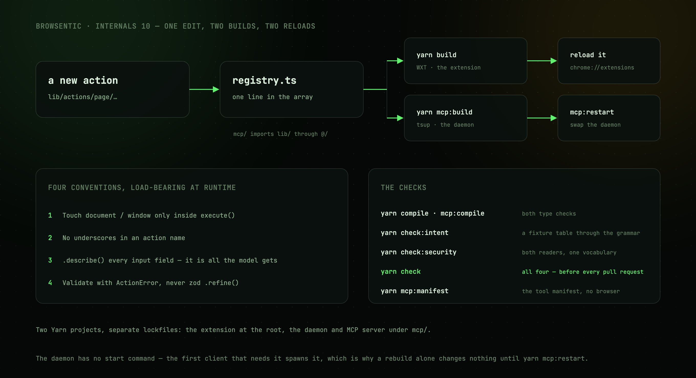

# Contributing

How the repository builds (a Cargo workspace, a Bun project and the macOS app), the checks a change
must pass, and how to add an action or a skill.



---

## Layout

| Path | What |
| --- | --- |
| `app/` | the `vexdom` binary: CLI (`app/src/cli/`), MCP server (`app/src/mcp/`), `read_url.rs`, native host |
| `crates/vexdom-schema` | `schema/vexdom.capnp`, the wire between extension, Bridge and clients |
| `crates/vexdom-core` | paths, config, tool manifest, skills (`assets/skills/`), guardrails, project config |
| `crates/vexdom-pure` | logic shared with the extension's wasm: sealing, intent, blocked sites, schedules, workflows |
| `crates/vexdom-snapshot` | refs, deltas, markdown and WebMCP text for snapshots |
| `crates/vexdom-link` | the Cap'n Proto link |
| `crates/vexdom-daemon` | the Bridge: invoke, pages, confirmations, agent runs, flows, vault, recordings |
| `crates/vexdom-client` | the client the CLI, MCP server and desktop app connect with |
| `crates/vexdom-update` | signed self-update (ADR-031) |
| `crates/ext-core` | Rust compiled to wasm with BoltFFI, loaded by the extension |
| `packages/extension/` | the extension (Bun, WXT; Chrome MV3 and Firefox MV2) |
| `desktop/` | `Vexdom.app` (GPUI), a Cargo workspace of its own |

---

## Prerequisites

| Tool | Version | Install |
| --- | --- | --- |
| Rust | 1.100.0, pinned by `rust-toolchain.toml` | `rustup toolchain install 1.100.0` |
| wasm target | — | `rustup target add wasm32-unknown-unknown` |
| Bun | 1.4.5 | `brew install oven-sh/bun/bun` |
| Cap'n Proto compiler | 1.5.0 | `brew install capnp` |
| BoltFFI CLI | 0.32.1, exactly | `cargo install boltffi_cli --version 0.32.1 --locked` |
| binaryen (`wasm-opt`) | 133 | `brew install binaryen` |

The extension's generated ext-core glue and wasm are git-ignored: on a fresh clone run
`bun run ext-core:build` (or any build) before `bun run compile`.

---

## Gates

Run all three before handing a change over.

```sh
# Rust, from the repository root
cargo fmt --check && cargo clippy --workspace --all-targets -- -D warnings && cargo test --workspace

# Extension, from packages/extension
bun run tools:emit && bun run check     # check = ext-core build, the Rust gates, tsc, vitest with coverage floors

# Desktop app, from desktop/
cargo fmt --check && cargo clippy --locked --all-targets -- -D warnings && cargo test --locked
```

`registry.test.ts` fails when the embedded manifest (`crates/vexdom-core/assets/tools.*.json`) is
out of step with the registry, which is why `tools:emit` comes first.

---

## Commands

In `packages/extension/`:

```sh
bun install
bun run dev | dev:firefox      # build ext-core, then WXT with hot reload
bun run build | build:firefox  # dist/chrome-mv3, dist/firefox-mv2
bun run zip
bun run lint:firefox           # web-ext lint on dist/firefox-mv2
bun run compile                # tsc --noEmit
bun run test                   # vitest; pass a path to run fewer
bun run test:link              # the extension against the real Bridge (cargo build -p vexdom first)
bun run coverage
bun run check:intent "<utterance>"   # how the local grammar routes one instruction
bun run tools:emit             # write crates/vexdom-core/assets/tools.{chromium,firefox}.json
bun run bridge:build           # cargo build --release -p vexdom → target/release/vexdom
bun run bridge:check           # the Rust gates
bun run bridge:install         # cargo install the Bridge onto PATH
```

`Vexdom.app`, from the root, after `bun run build`:

```sh
cargo build --release -p vexdom && (cd desktop && cargo build --release)
scripts/bundle-mac.sh target/release/vexdom desktop/target/release/vexdom-desktop \
  packages/extension/dist/chrome-mv3 <version> dist/mac
```

### A running Bridge keeps the old build

The Bridge starts on demand (a CLI command, an MCP client, the extension through the native host)
and keeps running. A rebuild changes nothing until it restarts: run `target/release/vexdom restart`.
Reload the extension at `chrome://extensions` after an extension build; Chrome does not reload
unpacked extensions by itself.

---

## Signing a Firefox build by hand

The release workflow signs tagged builds through addons.mozilla.org. By hand, only to check a change
against the signer:

- **AMO signs a version once per add-on id, ever.** Do not sign the version in `package.json`; add a
  fourth part to the built manifest instead:

  ```sh
  bun run build:firefox
  bun -e 'const p="dist/firefox-mv2/manifest.json";const m=await Bun.file(p).json();m.version+=".1";await Bun.write(p,JSON.stringify(m))'
  export WEB_EXT_API_KEY='user:…'   # addons.mozilla.org → Developer Hub → Manage API Keys
  read -s 'WEB_EXT_API_SECRET?AMO secret: ' && export WEB_EXT_API_SECRET
  bun run sign:firefox
  ```

- **Unlisted means self-hosted.** The signed file updates from the `update_url` in
  [wxt.config.ts](../../packages/extension/wxt.config.ts), the latest GitHub release.

Run `bun run lint:firefox` first; it should report no errors.

---

## Adding an action

A page action is one `defineAction` file and a few registrations.

1. **Define it** in `packages/extension/src/lib/actions/page/<name>.ts` with `defineAction` from
   [`core.ts`](../../packages/extension/src/lib/actions/core.ts): `name: 'page.<name>'` (no
   underscores), a `description` and a zod `input` with `.describe()` on every field (that text is
   all the agent gets), and `execute()`. Validate inside `execute()` with `ActionError`, not zod
   `.refine()`/`.transform()`, which do not survive JSON Schema. Set `chromiumOnly: true` when it
   needs the debugger, and `group` to put it under one of the playbooks.
2. **Register it** in the array in [`registry.ts`](../../packages/extension/src/lib/actions/registry.ts).
   An action the background resolves (tabs, the debugger, storage) gets its branch in
   [`bridge/invoke.ts`](../../packages/extension/src/lib/bridge/invoke.ts); its `execute()` then only
   throws.
3. **Choose its cue** in [`cues/plan.ts`](../../packages/extension/src/lib/cues/plan.ts): `plan.test.ts`
   fails for an action with no rule.
4. **Group** (optional): a new group goes in `TOOL_GROUPS` in
   [`groups.ts`](../../packages/extension/src/lib/actions/groups.ts) with its index line and skills.
5. **Emit the manifest**: `bun run tools:emit`, then rebuild the Bridge, which embeds it. Agents call
   it as `act {"do":"<name>", …}`; `guide {"topic":"<name>"}` and `vexdom tools` show its input.
6. **CLI verb** (optional): add the verb to `VERBS` in [`app/src/cli/page.rs`](../../app/src/cli/page.rs)
   or [`app/src/cli/verbs.rs`](../../app/src/cli/verbs.rs), any flag that takes a value to
   `VALUE_FLAGS` in [`app/src/cli/mod.rs`](../../app/src/cli/mod.rs), and a line to `usage()` there.

**If it is consequential**, add a rule (and, if needed, a `Condition`) to `DEFAULT_RULES` in
[`guardrails/mod.rs`](../../crates/vexdom-core/src/guardrails/mod.rs) rather than a check inside the
action. **If it should run without an agent**, add a rule to `RULES` in
[`crates/vexdom-pure/src/intent.rs`](../../crates/vexdom-pure/src/intent.rs) and a case to
[`intent.test.ts`](../../packages/extension/src/lib/bridge/intent.test.ts); bias toward escalating
([the intent funnel](agent-runs.md#the-intent-funnel)).

Bridge-side actions (`bridge.<name>`) are declared in
[`crates/vexdom-core/assets/bridge-actions.json`](../../crates/vexdom-core/assets/bridge-actions.json)
and implemented in the daemon.

---

## Adding a skill

- **Bundled**: write `crates/vexdom-core/assets/skills/<name>/SKILL.md` (front matter: `name`,
  `description`, `category`, `triggers`, `domains`, `default`), add it to `BUNDLED` in
  [`skills.rs`](../../crates/vexdom-core/src/skills.rs) (extra files go in `BUNDLED_FILES`), and add
  it to `MCP_SKILLS` if MCP clients should see it as a prompt, a `skill://<name>/SKILL.md` resource
  and a `guide` topic. A group playbook is also named in its `TOOL_GROUPS` entry.
- **Your own**: drop `<name>.md` or `<name>/SKILL.md` into `~/.vexdom/skills/`; it shadows a bundled
  skill of the same name and applies to the next run. See [Skill routing](agent-runs.md#skill-routing).

---

## See also

- [The action registry](registry.md): why the manifest cannot drift silently
- [Guardrails](guardrails.md): where enforcement lives
- [reference/cli.md](../reference/cli.md), [reference/errors.md](../reference/errors.md)
