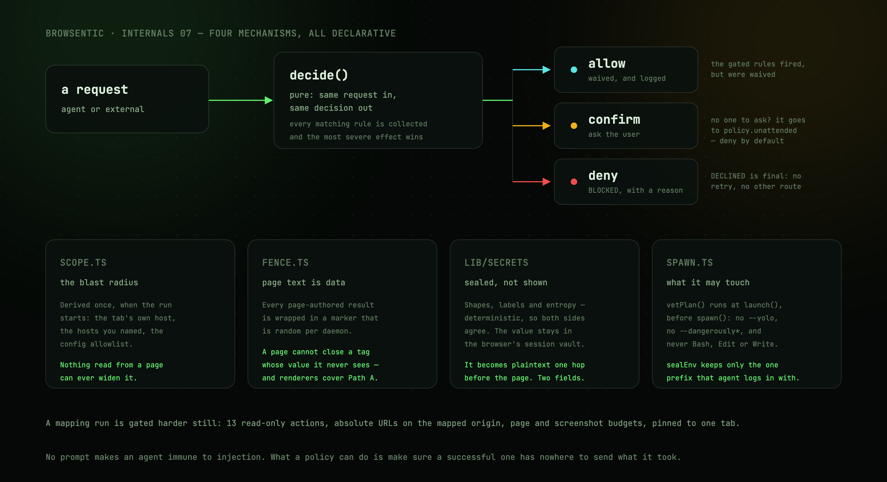

# Guardrails

What limits an agent driving the browser: a policy over page actions, approvals (in the side panel,
or from outside it for CLI and MCP callers), a per-run scope of hosts and tabs, fencing of page text,
sealed credentials, the user's blocked sites, and containment of the Claude Code process.



The Bridge joins three things that are normally kept apart: untrusted text from a page, a browser
holding live logged-in sessions, and an agent that can navigate anywhere. No prompt makes an agent
immune to injection, so these limits are enforced in code at the points every call passes.

| File | Governs |
| --- | --- |
| [`crates/vexdom-core/src/guardrails/mod.rs`](../../crates/vexdom-core/src/guardrails/mod.rs) | The policy: rules as data over a closed set of conditions, `decide()` |
| [`guardrails/scope.rs`](../../crates/vexdom-core/src/guardrails/scope.rs) | A run's hosts and tabs |
| [`guardrails/fence.rs`](../../crates/vexdom-core/src/guardrails/fence.rs) | Marking page text as data |
| [`guardrails/secrets.rs`](../../crates/vexdom-core/src/guardrails/secrets.rs) | The Bridge's sealing pass |
| [`guardrails/settings.rs`](../../crates/vexdom-core/src/guardrails/settings.rs) | The policy as the settings screens show it |
| [`guardrails/spawn.rs`](../../crates/vexdom-core/src/guardrails/spawn.rs) | What the spawned agent CLI may touch |
| [`crates/vexdom-core/src/approvals.rs`](../../crates/vexdom-core/src/approvals.rs) | "Always on this site" grants |
| [`crates/vexdom-daemon/src/confirmations.rs`](../../crates/vexdom-daemon/src/confirmations.rs) | Approvals for CLI and MCP callers (ADR-032) |
| [`crates/vexdom-pure/src/seal.rs`](../../crates/vexdom-pure/src/seal.rs), [`secrets.rs`](../../crates/vexdom-pure/src/secrets.rs) | Detecting, sealing and releasing credentials, shared with the extension |
| [`crates/vexdom-pure/src/blocked_sites.rs`](../../crates/vexdom-pure/src/blocked_sites.rs) | The blocked-sites patterns, enforced in the extension |

The decision is made in two places: `AgentSession::invoke_for_run()`
([`service.rs`](../../crates/vexdom-daemon/src/agent/service.rs)) for side-panel runs and
`invoke_external()` ([`invoke.rs`](../../crates/vexdom-daemon/src/invoke.rs)) for every other caller.
Fencing and sealing happen where MCP results are rendered ([`app/src/mcp/host.rs`](../../app/src/mcp/host.rs)),
containment in `launch()` ([`drive.rs`](../../crates/vexdom-daemon/src/agent/runners/drive.rs)).

---

## The policy

A rule is data: an id, a `Condition` from a closed enum, an `Effect` (`allow`, `confirm`, `deny`), a
title for the approval card and a reason for the agent. Adding a predicate means adding a
`Condition` variant, so the whole policy stays printable and overridable from config.

### The rules (`DEFAULT_RULES`)

| id | Default | Fires when |
| --- | --- | --- |
| `reserved-action` | **deny** | The action starts with `vexdom.` |
| `non-http-navigation` | **deny** | A navigation URL whose scheme is not `http` or `https` |
| `unreadable-navigation` | **deny** | A URL that resolves to no destination Vexdom can check |
| `off-scope-navigation` | confirm | The target host is outside the run's scope |
| `url-payload` | confirm | Query string plus fragment exceed `urlPayloadBytes` (512); not for `page.captureDownload` |
| `form-submission` | confirm\* | `page.submitForm`, `page.fillInput`/`page.typeText` with `pressEnter: true`, `page.pressKey` with `Enter` |
| `site-tool-call` | confirm | `page.callSiteTool` (a WebMCP tool the site registered) |
| `file-upload` | confirm | `page.attachFile` |
| `file-download` | confirm | `page.captureDownload` |
| `code-injection` | confirm | `page.injectCode` |
| `external-code-injection` | **deny** | `page.injectCode` from outside the side panel |
| `external-code-execution` | **deny** | `page.runCode` from outside the side panel |
| `leaves-pinned-tab` | confirm | A tab move away from the run's pinned tab to one it does not own or share |
| `captcha-solve` | confirm | `page.solveCaptcha` |
| `secret-release` | confirm | The input carries a sealed secret |
| `secret-off-scope` | confirm | …read on a site outside the run's scope |
| `secret-in-url` | **deny** | A sealed secret in a navigation URL |
| `config-require-approval` | confirm | The action is listed in `requireApproval` (except `page.submitForm`, which `form-submission` owns) |
| `network-body-read` | **deny** | `page.readNetwork` with `includeBodies: true` |
| `raw-html-read` | **deny** | `page.extractText` with `format: "html"` |

\* `form-submission` is `allow` unless `requireApproval` names `page.submitForm` (the legacy key
`policy_from()` still honours); a `guardrails.rules` override wins over both.

Why two reads are denied rather than confirmed: raw HTML carries comments, `aria-hidden` nodes and
off-screen text a page can hide from the person but still hand to the model; response bodies carry
session tokens and personal data wholesale, which pattern-based sealing does not catch.

### Evaluation

`decide()` is pure. Every rule whose effect is not `allow` and whose condition holds is collected;
the most severe effect wins (`allow` < `confirm` < `deny`), so declaration order does not matter. The
decisive rules (those at the winning severity) give the approval card's summary (`summary()`, titles
joined by ` · `), the log line (`describe()`, ids) and the agent's reason.

| Effect | Side-panel run (`Caller::Agent`) | CLI or MCP client (`Caller::External`) |
| --- | --- | --- |
| `deny` | `BLOCKED` with the reason | `BLOCKED` with the reason |
| `confirm` | approval card in the panel | waits for an external confirmation, or `allow` when `guardrails.unattended` is `"allow"` |
| `allow` with rules matched | — | logged as `waived` |

An external caller has no scope (`scope::anywhere()`), so the scope rules never fire for it.

### Overriding

```json
{
  "requireApproval": ["page.submitForm"],
  "guardrails": {
    "rules": { "off-scope-navigation": "deny", "raw-html-read": "allow" },
    "unattended": "allow",
    "urlPayloadBytes": 1024,
    "hosts": ["example.com"],
    "fence": false
  }
}
```

The settings page and the desktop app edit the same keys through
[`preferences.rs`](../../crates/vexdom-core/src/preferences.rs). `guardrail_settings()` derives every
row from `DEFAULT_RULES` and the live config; `setting_writable()` refuses unknown ids, wrong-shaped
values and the four locked rules (`reserved-action`, `non-http-navigation`, `unreadable-navigation`,
`secret-in-url`). A control connection that speaks for an agent run is refused `setPreference` with
`BLOCKED`: a run cannot loosen its own rules.

---

## Approvals

### In the side panel

`invoke_for_run()` sends an `approval` run event (tool id, action, input, the run's starting site)
and waits for the panel's answer: allow once, allow always on this site, or deny. Details are in
[Agent runs § A call through the run](agent-runs.md#a-call-through-the-run).

### External confirmations (ADR-032)

A `confirm` for a CLI or MCP caller is held by `await_confirmation()` in
[`confirmations.rs`](../../crates/vexdom-daemon/src/confirmations.rs):

1. A standing grant for the action on that site (the URL's host, else the target tab's) answers at
   once.
2. Otherwise a request `c-<8 hex>` is listed with the action, the summary, the site and a sealed input
   preview (2 KB), and every watcher of `Topic::ConfirmationsChanged` is told.
3. It waits up to `CONFIRM_WAIT_MS` (120 s, [`proto.rs`](../../crates/vexdom-core/src/proto.rs)).
   Allow runs the action (and stores a grant when "always" was chosen); deny returns `DECLINED`;
   no answer returns `APPROVAL_TIMEOUT`. The request leaves the list however the wait ends.
4. After an allow, `invoke_external` ([`invoke.rs`](../../crates/vexdom-daemon/src/invoke.rs)) asks
   for the action's site again (its `url`, or the tab's); if it is no longer the site the request
   named, nothing runs and the call returns `PAGE_CHANGED`.

Who can answer (`Control.confirm`):

| Where | How |
| --- | --- |
| Desktop app | lists and answers confirmations over the control socket |
| Terminal | `vexdom requests`, `vexdom approve c-… [--always]`, `vexdom deny c-…` ([`app/src/cli/confirm.rs`](../../app/src/cli/confirm.rs)); approving needs a terminal on stdin (`needs_terminal`), which stops an agent that simply runs `vexdom approve` but not a process running as the user that allocates one (`script`): it is a speed bump, not a boundary. A waiting page command prints `Waiting for approval c-…` on stderr once |
| MCP client | elicitation in [`app/src/mcp/mod.rs`](../../app/src/mcp/mod.rs), when the client declares the capability and the call is `act` outside a run: a form with **Allow once**, **Always allow on this site**, **Deny**. On the 2026-07-28 protocol the call returns `InputRequired` and resumes when the client calls again; on older ones the server asks mid-call |

Callers tag their input with `_approver` (`cli:<pid>`, `mcp:<session>:<call>`) so each finds its own
request; the tag is stripped before the action runs. A connection speaking for an agent run cannot
read or answer confirmations.

### Standing grants

[`approvals.rs`](../../crates/vexdom-core/src/approvals.rs) keeps `~/.vexdom/approvals.json`: one
action plus host per grant, the newest 200. A grant only short-circuits a `confirm`, never a `deny`.
`vexdom approvals` lists them; `vexdom approvals clear [host]` forgets them.

---

## Scope

A side-panel run's scope is built once, when it is admitted (`scope_for()` in
[`scope.rs`](../../crates/vexdom-core/src/guardrails/scope.rs)):

| Source | Adds |
| --- | --- |
| `guardrails.hosts` in config | each host; `"*"` makes the run unconfined |
| The tab it started on | its host |
| Tabs the user put in the conversation (`chosen`) | their hosts |
| The instruction's words | hosts named in prose (`HOST_IN_TEXT`), minus endings that are usually file names |

Nothing read from a page widens it. A run that starts with no host at all (a blank tab, nothing
named) gets `["*"]`. `normalize_host()` drops a trailing dot and a leading `www.` or `*.`, and a host
covers its subdomains.

`tab_id` pins the run to its starting tab. `owned_tab_ids` (tabs it opened) and `shared_tab_ids` (the
conversation's tabs) do not count as leaving it; the run's current tab moves with
`page.openTab`, `page.switchTab` and `page.closeTab`.

---

## Fencing

The MCP host wraps text from `page.*` results in a marker whose tag is random per server process:

```
<<<untrusted-page-data:a3f19c8e2b41>>>
…
<<</untrusted-page-data:a3f19c8e2b41>>>
```

`neutralize()` rewrites anything in the body that could pass for a marker (`<<<`, `>>>`, the tag).
The explanation (`FENCE_NOTE`) is stated once, in the server's instructions; screenshots carry
`IMAGE_NOTE`. `page.closeTab`, `page.stopMonitor` and `page.screenshot` are not fenced, and
`guardrails.fence: false` turns fencing off. External MCP clients get the fence too, since it is
applied where results are rendered, not in a prompt.

---

## Sealed secrets

A credential found in a result is replaced by a handle `⟦kind:id@host#tag⟧` that says what it was
without being it:

```
Your new password is ⟦password:7f3a@mail.example.com⟧
```

**Detection** is deterministic ([`vexdom-pure/src/secrets.rs`](../../crates/vexdom-pure/src/secrets.rs)):
known shapes (vendor key prefixes, JWTs, PEM blocks, Luhn-valid cards), values next to a credential
label or under a credential-named key, and high-entropy bare tokens. Both halves seal with the same
code, so the second pass leaves the first one's handles alone. `selector`, `ref` and `doc` values are
never scanned.

**The vault** is in the extension only:
[`secret-vault.ts`](../../packages/extension/src/lib/bridge/secret-vault.ts) keeps the plaintext in
`storage.session` under `vexdom/secrets`, 64 entries at most, two hours each, gone when the browser
restarts. The Bridge's pass ([`guardrails/secrets.rs`](../../crates/vexdom-core/src/guardrails/secrets.rs))
only seals; it has no way back.

**Release** happens in `invokeForHarness`
([`invoke.ts`](../../packages/extension/src/lib/bridge/invoke.ts)), one hop before the page, and only
in the fields of `RELEASE_FIELDS`:

```
page.fillInput  → value
page.typeText   → text
page.insertText → text
page.cookies    → value
```

A handle anywhere else is `SECRET_NOT_RELEASABLE`; one the vault no longer holds is
`SECRET_EXPIRED`. Release is still gated: `secret-release` asks, `secret-off-scope` says when the
value was read on another site, `secret-in-url` refuses.

**Forgery.** The tag is minted once per browser session and never rendered where a page reads it,
and the extension's strict sealing rewrites any bracket that is not its own handle, so a
page-planted handle resolves to nothing.

| Where | Seals |
| --- | --- |
| Extension, `invokeForHarness` | every action result before it crosses the socket |
| MCP host | every tool result, error message and resource body |
| `invoke_external()`, run summaries | the one-line summaries the side panel shows |
| The run's stream reader | Claude Code's text deltas (`StreamSealer`, holding back a possible half secret) |
| Confirmations | the input preview |

---

## Blocked sites

The user's blocked-sites list lives in the extension's `storage.local` (`vexdom/blockedSites`, up to
500 patterns of at most 200 characters). Patterns compile in
[`blocked_sites.rs`](../../crates/vexdom-pure/src/blocked_sites.rs) through ext-core, and
[`site-guard.ts`](../../packages/extension/src/lib/bridge/site-guard.ts) checks the target tab before
any action is dispatched and where it landed afterwards, refusing with `SITE_BLOCKED`. An unreadable
list blocks every web page. The Bridge never receives the list; `vexdom read <url>` and
`snapshot {"as":"markdown","url":…}` ask the browser (`page.checkSites`) before fetching each URL
and redirect hop. `page.checkSites` is one of scope's `NAVIGATIONS`
([`scope.rs`](../../crates/vexdom-core/src/guardrails/scope.rs)), so the same call runs the
navigation rules (scope, `url-payload`) on that URL. Over MCP,
[`read_url.rs`](../../app/src/read_url.rs) then refuses a host that is, or resolves to, a loopback,
private, link-local, CGNAT or unspecified address (`READ_REFUSED`) unless `VEXDOM_READ_PRIVATE` is
set, and [`host.rs`](../../app/src/mcp/host.rs) drops agent-supplied `headers`. The CLI reads local
addresses.

---

## Spawn containment

The policy governs what the agent does to a page. Containment governs what the Claude Code process
may do on the machine, where `decide()` never looks.

### `vet_plan()`

Every spawn plan is checked before the process exists; a failure is `AGENT_UNSAFE` and nothing
starts:

| Check | `run` mode (drives the browser) | `task` mode (one-shot) |
| --- | --- | --- |
| Required arguments | `--strict-mcp-config`, `--allowedTools` | `--strict-mcp-config`, `{"mcpServers":{}}` |
| `--disallowedTools` must name | `Bash Edit Write NotebookEdit Glob Grep Task Read` | `Bash Edit Write NotebookEdit Glob Grep Task` |
| Forbidden anywhere | `--dangerously…`, `--yolo`, `--force`, `--auto-approve`, `--full-auto`, `--no-sandbox`, `--allow-all…`, `--permission-mode bypassPermissions\|acceptEdits`, `-y`, `-f`, … | same |
| `--model` value | must be a model id, not something read as a flag | same |
| Working directory | inside `~/.vexdom` | same |

The runner itself denies more (`BUILTIN_DENIED` in
[`claude.rs`](../../crates/vexdom-daemon/src/agent/runners/claude.rs): also `Monitor`, `Workflow`,
`Skill`, `ToolSearch`, the cron and worktree tools, …) and passes `--tools ""` so Claude Code's
built-in tools are off; `vet_plan()` checks the minimum.

### Sealing the environment

`seal_env()` drops every variable whose name contains a credential word as a segment (`KEY`,
`TOKEN`, `SECRET`, `PASSWORD`, `AUTH`, `SESSION`, `COOKIE`, …) or starts with a known vendor prefix
(`AWS_`, `GITHUB_`, `NPM_`, `OPENAI_`, `STRIPE_`, `DATABASE_`, …), except Claude Code's own
`ANTHROPIC_` and `CLAUDE_` variables, plus `AWS_` with `CLAUDE_CODE_USE_BEDROCK` and
`GOOGLE_`/`GCLOUD_`/`CLOUDSDK_` with `CLAUDE_CODE_USE_VERTEX`. The log records how many were sealed.

---

## The mapping gate

A site-mapping run's calls skip the policy and go through `gate_mapping_invoke()`: read-only actions
on one origin within a page and screenshot budget. See
[Agent runs § Site mapping](agent-runs.md#site-mapping).

---

## Next

**[Subsystems →](subsystems.md)**

The user-facing view: [guide/approvals.md](../guide/approvals.md).
