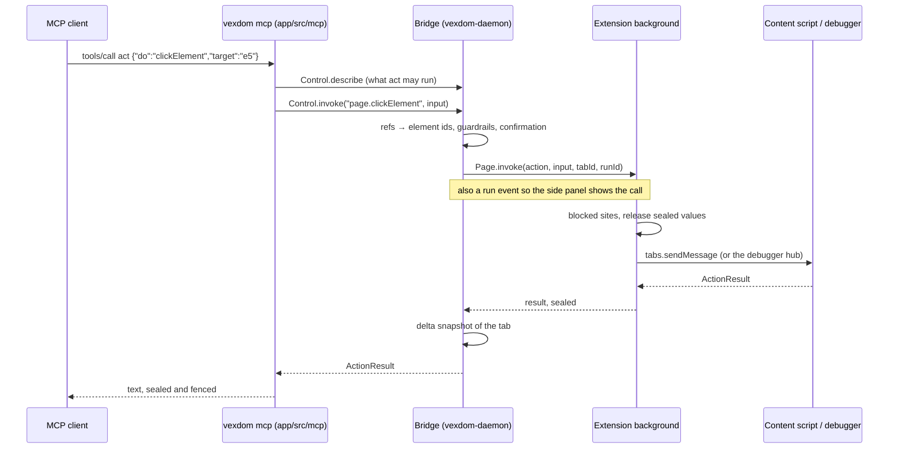

# Request path

This page follows one MCP `act` call from the client to the page and back, then the same call made
from the CLI. A side-panel run takes the same route from `vexdom mcp` on; its differences are at
the end and in [Agent runs](agent-runs.md).

---

---

## 1. The MCP server (`app/src/mcp/`)

`vexdom mcp` is an rmcp server on stdio (`mod.rs`) that answers both the 2026-07-28 era
(`server/discover`, stateless requests) and the legacy `initialize` handshake. On start it
connects to the Bridge with `vexdom_client::Bridge::connect`, which runs `ensure_daemon()` (start
the Bridge if none answers) and opens a control socket with the lockfile's token.

`tools/list` shows three tools (`host.rs`): `snapshot`, `act`, `guide`. `act` takes
`{"do":"<action>", ...input}` or `{"batch":[{"do":…},…],"bail":true}`.

For `act`, `Host::act`:

1. calls `Control.describe` and builds the offer (`Host::offer()`), dropping withheld actions and
   the ones the MCP server never runs (`bridge.authSave`, `page.checkSites`);
2. resolves the name with `resolve_action()`; an unknown one is `UNKNOWN_ACTION` with the closest
   names;
3. runs `bridge.diff` and `bridge.state` in its own process (`diff` as `Caller::Agent`: a
   `baseline` only from `~/vexdom/captures`, and only a snapshot text or a PNG); drops `allowWrite`
   from a `bridge.flowRun` (`strip_agent_only`), so each flow write asks; everything else goes to
   `Bridge::invoke`, which calls `Control.invoke(action, input, runId)`;
4. on `INVALID_INPUT`, appends the action's input schema to the message, so the agent can correct
   itself without calling `guide`.

A batch runs its steps in order, one line per step (`3. clickElement ok: …` or
`3. clickElement failed: CODE: message`), and with `bail: true` stops at the first failure.

**Timeouts.** Outside a run, the client waits `invoke_timeout()` (`crates/vexdom-client`): 60 s by
default, a declared `timeoutMs` plus 10 s, longer for `screenshot`, `awaitMonitor`, `pickElement`
and `solveCaptcha`, plus 120 s when the call carries an approver tag. A call that gets no answer
is reported as the Bridge being unreachable. Calls inside a run wait without a client timeout.

---

## 2. Approval through the MCP client

When the client supports elicitation and the call is an `act` outside a run, `Server::call_tool`
tags the input with `_approver: "mcp:<session>:<n>"` and watches `confirmationsChanged`. If the
Bridge lists a confirmation with that tag, the server asks the user through the client:

- **2026-07-28 era**: it answers `InputRequired` with an elicitation and the confirmation id as
  `requestState`; the client calls again with the answer, which goes to `Control.confirm`. A
  repeat call for a confirmation no longer waiting gets `CONFIRM_EXPIRED`.
- **Legacy era**: it sends an elicitation request during the call and waits up to 120 s.

Either way the user can also answer from `Vexdom.app` or `vexdom approve`. A `flowRun`'s write
approvals carry the same tag (the flow handler passes the call's approver to each
`await_confirmation`), so they reach the client's prompt too. After an allow, `invoke_external`
checks the action's site again and answers `PAGE_CHANGED` without running it if the tab moved to
another site meanwhile.

---

## 3. The Bridge (`crates/vexdom-daemon/`)

`Control.invoke` in `control.rs` branches:

- with a run id: the run's own path (see the end of this page);
- `page.snapshot` or `page.readHtml`: refused with `UNKNOWN_ACTION` (the Bridge calls those
  itself, for `snapshot` and `read`);
- anything else: `page_invoke()` in `page.rs`, on the browser this connection is bound to
  (`route_for()`: a burst of calls stays with one browser; after two idle minutes the connection
  follows the most recently active one).

`page_invoke()`:

1. **Refs.** `rewrite_refs()` replaces a ref (`"e5"` or `{"ref":"e5"}`) in `target`, `from`,
   `to`, `frame` or `container` with the element it names in that tab's last snapshot (frame id,
   document key, element id, role, name). No snapshot of the tab is `NO_SNAPSHOT`; a ref not in it
   is `UNKNOWN_REF`. A plain string becomes `{"selector": …}`.
2. **Guardrails** (`invoke_external()` in `invoke.rs`). The request is decided with
   `Caller::External` and the unscoped `anywhere()` scope. Deny is `BLOCKED`. Confirm waits in
   `await_confirmation()` (`confirmations.rs`, ADR-032): a request `c-xxxxxxxx` is listed to
   `confirmationsChanged` watchers with a sealed preview of the input, and the call waits up to
   **120 s** for `Control.confirm` from `Vexdom.app`, `vexdom approve c-… [--always]` /
   `vexdom deny c-…`, or the MCP client. A refusal is `DECLINED`, no answer `APPROVAL_TIMEOUT`.
   A standing "always on this site" grant answers at once. See [Guardrails](guardrails.md).
3. **Visibility.** A `tool` run event with `source: "external"` goes to the extension under the run
   id `external`, then a `toolResult`, so the side panel shows what outside callers did.
4. **Invoke** (`invoke_on()`). Reserved `vexdom.*` names are refused; `bridge.auth*` goes to the
   auth vault; `page.listDownloads` is answered from the Bridge's own records; `a11yAudit` gets
   axe-core's source attached (fetched once into the Bridge's cache, `devtools.rs`);
   `recordStart`/`recordStop` start and finish the ffmpeg encoder (`recording_video.rs`);
   attachment paths are resolved; then `Link::invoke` calls the extension.
5. **Artifacts.** `page.pdf`, `page.harStop` and `page.traceStop` go through `Page.artifact`; the
   bytes come back as `Data` and `artifacts.rs` writes them to the absolute `path` the caller gave
   (never inside the state folder) or to `~/vexdom/captures/<kind>-<unix_ms>.<ext>`, at most
   48 MiB.
6. **Delta.** For actions that change the page (`clickElement`, `fillInput`, `typeText`,
   `insertText`, `selectOption`, `setChecked`, `pushState`, `pressKey`, `submitForm`, `navigate`,
   `mouse`, `dialog`) on a tab that has a snapshot, the Bridge waits 150 ms, snapshots again and
   answers `{"result": …, "snapshot": "<delta>"}`.
7. **WebMCP.** After navigation-like actions, the reply carries the tab's WebMCP context when its
   tools changed since the last announcement (`webmcp.rs`; see [WebMCP](../guide/features/webmcp.md)).

`page.screenshot` takes its own branch: `annotate` takes a snapshot and sends ref labels to draw,
the image comes back as bytes over `Page.screenshot`, and `ifChanged` answers
`Screenshot unchanged since the last one.` when the capture matches the last one (by hash, or
within `threshold` of its pixels).

**Bridge → extension timeouts** (`timeout_for()` in `link.rs`): 30 s by default, a declared
`timeoutMs` plus 5 s, 120 s for a screenshot, `traceStop`, `pdf`, `harStop`, `vitals`,
`a11yAudit` and `react`, and the computed typing time plus 30 s for `typeText`. A timeout is
`TIMEOUT`; a dropped link is `EXTENSION_OFFLINE`.

---

## 4. The extension (`packages/extension/src/lib/bridge/`)

`socket.ts` receives the `PageCall` from ext-core and calls `invokeForHarness()` in `invoke.ts`:

1. **Blocked sites** (`guardTarget`): the target tab's address and pending address, every frame on
   the focused path, and where the action would send the browser are checked against the user's
   list. A tab that is not an http(s) page is `TAB_UNREACHABLE` (except for `navigate`).
2. **Release** (`releaseForAction` in `secret-vault.ts`): a sealed placeholder becomes the real
   value only in a field that types into the page (`fillInput.value`, `typeText.text`,
   `insertText.text`, `cookies.value`) and only for the origin it was sealed on; otherwise
   `SECRET_NOT_RELEASABLE` or `SECRET_EXPIRED`.
3. **Dispatch**: storage-only actions are answered in the background; the rest find their tab
   (the run's tab, else the given `tabId`, else the active tab) and go through `routeInTab`, which
   sends tab, navigation, frame, screenshot, snapshot, debugger and code actions to their module
   and everything else to the content script, in the frame a ref names or the focused frame.
4. **Landing check** (`guardLanding`): if the tab ended up on a blocked site, the result is
   replaced by the refusal.
5. **Seal** (`sealForPage`): secrets in the result are replaced with placeholders such as
   `⟦password:4f2a@example.com⟧` before anything crosses the socket.

In the content script, `actions/host.ts` asks the background whether its own page is blocked
(`siteRefusal`), then `actions/dispatch.ts` parses the input with the action's zod schema
(`INVALID_INPUT`), runs `execute()`, and maps an `ActionError` to its code (`ACTION_FAILED`
otherwise). Details: [Inside the extension](extension.md).

---

## 5. Back to the client

`render()` in `host.rs` turns the result into one text block: the data as compact JSON (a delta
appended as text), passed through `seal_secrets()` again, and **fenced** for `page.*` actions:
wrapped in `<<<untrusted-page-data:TAG>>>` … `<<</untrusted-page-data:TAG>>>` with a random tag
minted per MCP server process, and any marker inside the body neutralized. The note explaining the
fence is in the server instructions, not repeated per result. Errors become `CODE: message` with
`isError`. Screenshots, an A-Eye pick and a captcha challenge come back as image blocks with an
untrusted-content note.

Text is cut to 20,000 characters by default (`--max-output`, `VEXDOM_MAX_OUTPUT` or the project's
`vexdom.json`; `0` means no limit).

---

## The same call from the CLI

`vexdom click @e5` (`app/src/cli/page.rs`) builds the same `page.clickElement` input, adds
`_approver: "cli:<pid>"` (and `tabId` from `--tab`), connects with `Bridge::connect`, and calls
`Control.invoke`. From there it is the path above, steps 3 to 4. If the Bridge lists a confirmation
with that tag, the CLI says so once on stderr (`confirm.rs`) while the call waits; approve it from
another terminal with `vexdom approve c-…` or from `Vexdom.app`. `vexdom snapshot` and `vexdom read`
call `Control.snapshot` and `Control.read`, the same calls the MCP `snapshot` tool makes. Results
are printed sealed but not fenced. `vexdom mcp call <tool> [json]` runs one MCP tool call from the
shell.

---

## Inside a side-panel run

Claude Code's `vexdom mcp` has `VEXDOM_AGENT_RUN` set, so every call carries the run id.
`Control.invoke` with a run id goes to `AgentSession::invoke_for_run`
(`crates/vexdom-daemon/src/agent/service.rs`): `allowWrite` is dropped from a `bridge.flowRun`,
the run's reserved actions are answered there, the
guardrails decide with `Caller::Agent` and the run's scope, a Confirm becomes an approval card in
the side panel instead of an external confirmation, and the action goes to `invoke_on()` with the
run id so the extension acts in the run's own tab. See [Agent runs](agent-runs.md).

---

## Next

**[Inside the extension →](extension.md)**: what happens after the `Page.invoke` call arrives.
