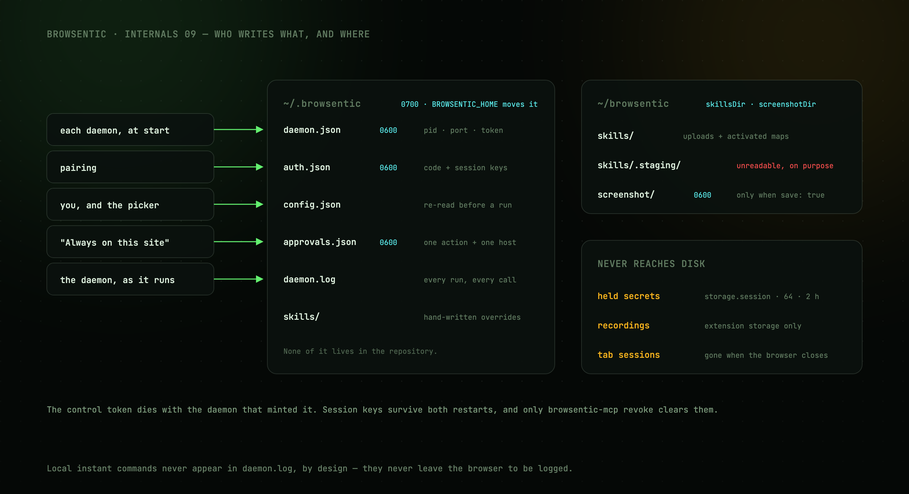

# State on disk

Where Vexdom keeps its state: `~/.vexdom` (the Bridge's private folder), `~/vexdom` (files meant
for you), a project's `./vexdom.json`, and the browser's own storage for what never reaches disk.
Paths come from [`crates/vexdom-core/src/paths.rs`](../../crates/vexdom-core/src/paths.rs).



Every JSON file under `~/.vexdom` is written by `write_private_json()` or `write_private()`: a 0600
file in a 0700 folder.

```
~/.vexdom/                      0700; VEXDOM_HOME moves it
├── daemon.json          0600   lockfile: pid, port, control token, protocolVersion, daemonVersion
├── daemon.start.lock           only while a Bridge is being started
├── stopped              0600   only after `vexdom stop`: the native host leaves the Bridge down
├── daemon.log, daemon.log.1    the Bridge log, rotated past 2 MiB
├── config.json          0600   settings, agent, guardrails, plugins, CLI defaults
├── auth.json            0600   pairing codes, paired browsers, allowed and blocked browsers
├── profile.json         0600   the settings page's Profile
├── approvals.json       0600   "always on this site" grants
├── schedules.json       0600   scheduled tasks and their recent runs
├── downloads.json       0600   the index of captured downloads
├── desktop.json         0600   the macOS app's own settings
├── skills/                     hand-written skills (the `user` layer)
├── states/                     `vexdom state save`: one JSON file per name, 0600
├── flows/<host>/<name>         saved flows, 0600 files in 0700 folders
├── vault/                      saved logins, one AES-256-GCM file each, 0600
├── .vault-key           0600   the vault key, unless VEXDOM_VAULT_KEY is set
├── cache/axe-core-<v>.min.js   axe-core, fetched once
├── agents/claude/prompts/      each run's system prompt file, swept after a day
├── tmp/                        one-shot scratch files (file and captcha analysts), deleted after use
└── native-host/                the native-messaging launcher and, on macOS, bridge-job.plist

~/vexdom/                       not relocatable as a whole
├── extension/chrome-mv3/       what `vexdom setup --unpacked` writes
├── skills/                     uploads and activated site maps (`skillsDir`)
│   └── .staging/<id>/          site maps awaiting review, never loaded as skills
├── screenshot/                 screenshots taken with save: true (`screenshotDir`)
├── download/                   captured downloads (`downloadDir`), 0600
└── captures/                   PDF, HAR and trace files with no `path`, 0600
```

| File | Written by | Notes |
| --- | --- | --- |
| `daemon.json` | each Bridge at startup ([`lockfile.rs`](../../crates/vexdom-core/src/lockfile.rs)) | How clients find the Bridge. The token dies with the Bridge that minted it; `vexdom token` prints it. `VEXDOM_LOCKFILE` moves it |
| `stopped` | `vexdom stop`, `vexdom restart` | Holds an ISO time. The next Bridge to start removes it |
| `daemon.log` | the Bridge ([`log.rs`](../../crates/vexdom-core/src/log.rs)) | `vexdom logs`. Run starts, routed skills, each tool call and outcome, confirmations. Local [instant commands](../guide/features/instant-commands.md) never appear |
| `config.json` | you, `vexdom agent`, `vexdom pairing`, `vexdom plugin`, the settings page and the desktop app ([`config.rs`](../../crates/vexdom-core/src/config.rs), [`preferences.rs`](../../crates/vexdom-core/src/preferences.rs)) | Read on every use, written read-modify-write so unknown keys survive. [Reference](../guide/configuration.md) |
| `auth.json` | pairing ([`auth_store.rs`](../../crates/vexdom-core/src/auth_store.rs)) | `pairings`, `sessions` (key, origin, install id, browser, label, `pairedBy`, versions, times), `approved` and `blocked` browsers. Pairing grants and requests stay in memory |
| `profile.json` | the settings page ([`profile.rs`](../../crates/vexdom-core/src/profile.rs)) | Read before every run; kept apart so `config.json` holds no personal details |
| `approvals.json` | **Always on this site** ([`approvals.rs`](../../crates/vexdom-core/src/approvals.rs)) | `vexdom approvals`, `vexdom approvals clear [host]` |
| `schedules.json` | the Schedules tab, `vexdom tasks` ([`schedules.rs`](../../crates/vexdom-core/src/schedules.rs)) | At most 25 tasks |
| `downloads.json` | `page.captureDownload` ([`downloads.rs`](../../crates/vexdom-core/src/downloads.rs)) | Entries older than 14 days are swept with their files |
| `desktop.json` | `Vexdom.app` ([`desktop/src/settings.rs`](../../desktop/src/settings.rs)) | `appearance`, `startBridgeOnLaunch`, `finishUpdateOnLaunch` |
| `states/` | `vexdom state save`, `act {"do":"state"}` ([`app/src/cli/state.rs`](../../app/src/cli/state.rs)) | Cookies and web storage; credential values are saved sealed, so they release only in the browser session that sealed them |
| `flows/` | `vexdom flow save` ([`flow/mod.rs`](../../crates/vexdom-daemon/src/flow/mod.rs)) | See [Flows](../guide/features/flows.md) |
| `vault/`, `.vault-key` | `vexdom auth save` ([`auth_vault.rs`](../../crates/vexdom-daemon/src/auth_vault.rs)) | The key file is created by the first save. See [Saved logins](../guide/features/auth-vault.md) |
| `cache/` | `page.a11yAudit` ([`devtools.rs`](../../crates/vexdom-daemon/src/devtools.rs)) | A cache: deleting it means one more download |
| `native-host/` | `vexdom setup` and every Bridge start ([`native_host.rs`](../../crates/vexdom-daemon/src/native_host.rs), [`quarantine.rs`](../../crates/vexdom-daemon/src/quarantine.rs)) | The launcher browsers start; on macOS the launchd job that starts the Bridge outside the browser's quarantine |

Nothing the Bridge writes for you goes into `~/.vexdom`: an artifact `path` inside it is refused.

## The project file

[`project_config.rs`](../../crates/vexdom-core/src/project_config.rs) reads CLI preferences from
`config.json` under `"cli"`, overridden by `./vexdom.json` in the working directory (never a parent).
The project file is untrusted: only display and timing preferences are read from it, and it can
never add a plugin.

## State kept in the browser

**Held secrets** stay in the extension's `storage.session` under `vexdom/secrets`: 64 entries at
most, two hours each, emptied when the browser restarts. The Bridge never receives one.

**`storage.session`** (gone when the browser closes): tab sessions (`vexdom/tabSessions`),
diagnostics buffers (`vexdom/diagnostics`), monitors (`vexdom/monitors`), timers (`vexdom/timers`),
the recording in progress (`vexdom/recording`), hands-free state (`vexdom/handsFree`,
`vexdom/dictation`, `vexdom/approvalsAnnounced`), notices the app opened (`vexdom/noticeTabs`, the
newest 30) and `vexdom/staleKey` once the Bridge has said it holds no session for the stored key.

**`storage.local`** (until the extension is removed):

| Key | Holds |
| --- | --- |
| `vexdom:sessions` | panel conversations (50) |
| `vexdom:files` and `vexdom:file:<id>` | attached files and their reports |
| `vexdom:recordings` | recordings (20) |
| `vexdom/savedTools` | saved page tools; one that runs on every visit is also registered as a user script |
| `vexdom/blockedSites` | blocked-sites patterns (500) |
| `vexdom/newTab`, `vexdom/newTab.paint` | Vexdom Home settings and up to 100 hidden hosts |
| `vexdom/theme`, `vexdom/theme.unsynced` | the theme mirrored from `config.json`, and a pick the Bridge has not heard yet |
| `vexdom/pairManual`, `vexdom/pairLast` | Disconnect pressed; the last pairing attempt |
| `vexdom/orbPosition`, `vexdom/pushToTalk`, `vexdom/speechService` | hands-free preferences |
| `vexdom/contextMenu`, `vexdom/actionCues`, `vexdom/starNudge` | right-click items, on-page action rings, the star request |

## Relocating

`VEXDOM_HOME` moves `~/.vexdom` wholesale; `VEXDOM_LOCKFILE` moves only the lockfile.
`skillsDir`, `screenshotDir` and `downloadDir` in `config.json` move those `~/vexdom`
subfolders; `~` and relative paths start at the home folder. `vexdom uninstall` removes both
folders.

---

## Next

**[Contributing →](contributing.md)**
