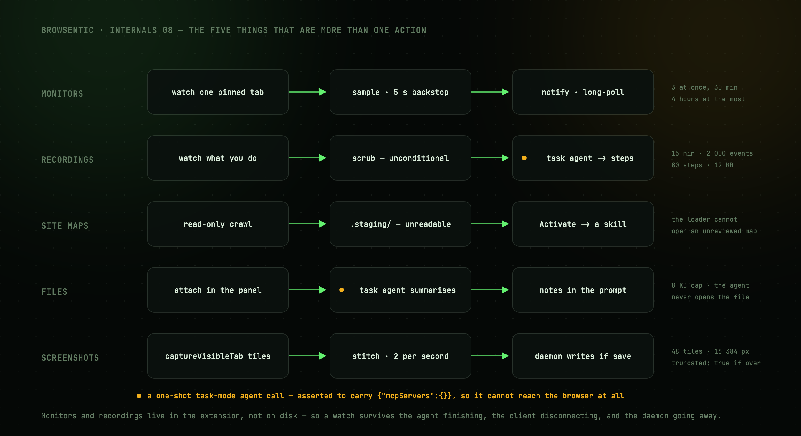

# Subsystems

The features built from more than one action or kept running across calls: monitors, timers,
schedules, diagnostics, recordings, site maps, files and downloads, screenshots, files the Bridge
writes (PDF, HAR, trace, video), the axe-core cache, the WebMCP announcement and reading a page over
HTTP.

---

## Monitors

[`packages/extension/src/lib/monitor/`](../../packages/extension/src/lib/monitor/),
[`bridge/monitor.ts`](../../packages/extension/src/lib/bridge/monitor.ts)

`page.startMonitor` watches one tab in the background until a condition completes: an element
appearing or going, text or title matching, a progress value reaching a threshold.
`page.findProgress` picks a signal first; `page.monitorStatus`, `page.awaitMonitor` and
`page.stopMonitor` follow it.

| | ([`monitor/events.ts`](../../packages/extension/src/lib/monitor/events.ts)) |
| --- | --- |
| At once | 3 (`MAX_MONITORS`) |
| Duration | 30 minutes default, 4 hours at most |
| Stall warning | 2 minutes with no change |
| `page.awaitMonitor` | 2 minutes default, 10 at most per call |
| Sampling | debounced 500 ms, at most every 3 s, with a 5 s backstop tick |

Completion raises a browser notification. State is in `storage.session` (`vexdom/monitors`), so a
watch survives the agent finishing, the MCP client leaving and the Bridge going away, but not the
browser closing.

---

## Timers

[`packages/extension/src/lib/timers/`](../../packages/extension/src/lib/timers/),
[`bridge/timer.ts`](../../packages/extension/src/lib/bridge/timer.ts)

`page.startTimer` wakes a side-panel conversation with a prompt later, once or repeatedly
("every two minutes refresh the queue"). `page.timerStatus` and `page.stopTimer` follow it.

| | ([`timers/events.ts`](../../packages/extension/src/lib/timers/events.ts)) |
| --- | --- |
| At once | 5 |
| Interval | 30 s to 24 hours |
| Runs | 12 by default, 500 at most |
| Prompt | 2,000 characters |
| Busy conversation | retried after 60 s, skipped at most 20 times |

Timers live in `storage.session` (`vexdom/timers`) and Chrome alarms.

---

## Scheduled tasks

[`crates/vexdom-pure/src/schedules.rs`](../../crates/vexdom-pure/src/schedules.rs) (rules and
validation), [`crates/vexdom-core/src/schedules.rs`](../../crates/vexdom-core/src/schedules.rs)
(`~/.vexdom/schedules.json`), [`crates/vexdom-daemon/src/scheduler.rs`](../../crates/vexdom-daemon/src/scheduler.rs)
(the clock).

A scheduled task is an instruction the Bridge starts on a calendar rule. One clock is re-armed to the
next due task (at most a minute away) and dispatches `runTask` to a connected browser, which starts
an ordinary side-panel run with `context.task` set.

| | |
| --- | --- |
| Tasks | 25 |
| Every N minutes | 5 minutes to 7 days |
| Times per day | 12 |
| Instruction | 2,000 characters, 20 variables |
| Runs kept per task | 20 |
| An approval nobody answers | `APPROVAL_TIMEOUT` after 10 minutes |
| A run | cut after 20 minutes |

`vexdom tasks`, `vexdom tasks pause|resume [id]` and `vexdom tasks delete <id>` edit the same file;
clock times are the system's local time in the Bridge and the browser's in the extension.

---

## Diagnostics

[`packages/extension/src/lib/diagnostics/`](../../packages/extension/src/lib/diagnostics/),
[`bridge/diagnostics.ts`](../../packages/extension/src/lib/bridge/diagnostics.ts)

`page.startDiagnostics` holds a debugger lease on a tab (the per-tab hub in
[`cdp.ts`](../../packages/extension/src/lib/bridge/cdp.ts)) and records console messages, exceptions
and network requests until `page.stopDiagnostics`, the timeout, the run that opened it ending, the tab
closing or DevTools taking the session. `page.readConsole` and `page.readNetwork` read the buffers.
Chromium-only.

| | ([`diagnostics/events.ts`](../../packages/extension/src/lib/diagnostics/events.ts)) |
| --- | --- |
| At once | 2 sessions |
| Duration | 5 minutes default, 30 s to 30 minutes |
| Console ring | 500 entries |
| Network ring | 1,000 requests |
| Per entry | 2,000 characters, 8 stack frames |

Buffers sit in `storage.session` (`vexdom/diagnostics`). Results are sealed on their way out like any
other; bodies are only returned when the [`network-body-read`](guardrails.md#the-rules) rule lets the
call through.

---

## Recordings

[`packages/extension/src/lib/recordings/`](../../packages/extension/src/lib/recordings/),
[`bridge/recorder.ts`](../../packages/extension/src/lib/bridge/recorder.ts),
[`bridge/recording-store.ts`](../../packages/extension/src/lib/bridge/recording-store.ts)

The content script records what the user does in one tab (clicks, fills, selects, keys, submits,
scrolls, navigations) and the background keeps it.

| | |
| --- | --- |
| Duration | 15 minutes, warning at 13 |
| Events | 2,000 |
| Recordings kept | 20 (`storage.local`, `vexdom:recordings`) |
| Workflow | 80 steps, 20 variables, 12 KB |

Passwords, hidden fields, one-time codes and card numbers are dropped whatever the settings; typed
values become `{{placeholders}}` unless the user asked to keep them. On stop, a one-shot Claude Code
call with no browser ([`recording.rs`](../../crates/vexdom-daemon/src/agent/recording.rs)) turns the
trace into named steps, checked by [`vexdom-pure/src/workflow.rs`](../../crates/vexdom-pure/src/workflow.rs).
Agents read them with `page.listRecordings` and `page.readRecording`. A site on the blocked list is
not recorded.

---

## Site maps

Generated site skills, written by a mapping run to `<skillsDir>/.staging/<id>/` and activated by the
user. See [Agent runs § Site mapping](agent-runs.md#site-mapping).

---

## Files and downloads

**Attached files** live in the extension (`storage.local`, index `vexdom:files`,
[`file-store.ts`](../../packages/extension/src/lib/bridge/file-store.ts)); files over 10 MB keep only
their name and size. The Bridge's [file analyst](agent-runs.md#the-file-analyst) reads each once;
the agent sees the report and `page.listFiles`, and puts a file into a page with `page.attachFile`
(`file-upload` rule).

**Downloads** are owned by the Bridge ([`crates/vexdom-core/src/downloads.rs`](../../crates/vexdom-core/src/downloads.rs)),
the half with a filesystem and the run's scope. `page.captureDownload` (`file-download` rule) makes
the page download a file in its own session; the Bridge moves it into `downloadDir` (default
`~/vexdom/download/`, 0600) and records it in `~/.vexdom/downloads.json`. The agent gets notes about
what arrived, never the bytes.

| | |
| --- | --- |
| Largest download | 100 MB |
| Largest attachment from disk | 25 MB, 20 files |
| Kept | 14 days, then swept |

`page.listDownloads` is answered by the Bridge alone; `vexdom downloads` lists and
`vexdom downloads clear` deletes them.

---

## Screenshots

[`bridge/screenshot.ts`](../../packages/extension/src/lib/bridge/screenshot.ts)

The viewport is one capture. `fullPage: true` scrolls and stitches tiles, paced by the browser's
capture limit (500 ms apart), capped at 48 tiles and a 16,384 px canvas side. A background tab is
captured through the debugger on Chromium.

Nothing is written unless `save: true` was passed or a mapping run gave a staging path; then
`save_screenshot()` writes to `screenshotDir` (default `~/vexdom/screenshot/`). The CLI's
`--if-changed` and `--annotate` are handled in [`page.rs`](../../crates/vexdom-daemon/src/page.rs).

---

## Files the Bridge writes: PDF, HAR, trace

[`crates/vexdom-daemon/src/artifacts.rs`](../../crates/vexdom-daemon/src/artifacts.rs),
[`bridge/capture.ts`](../../packages/extension/src/lib/bridge/capture.ts),
[`bridge/har.ts`](../../packages/extension/src/lib/bridge/har.ts)

`ARTIFACT_ACTIONS` are `page.pdf`, `page.harStop` and `page.traceStop` (`page.harStop` with
`inline: true` returns the HAR instead). For these the Bridge calls the extension's
`Page.artifact` capnp method, which returns the bytes beside the result, and writes the file:

- to the caller's `path`, which must be absolute and outside `~/.vexdom` (symlinks resolved), else
  `INVALID_INPUT` before anything runs;
- otherwise to `~/vexdom/captures/<stem>-<unix_ms>.<ext>`.

Files are 0600 in a 0700 folder, at most 48 MB. All three need the debugger, so they are
Chromium-only (`UNSUPPORTED` on Firefox).

---

## Video recording

[`crates/vexdom-daemon/src/recording_video.rs`](../../crates/vexdom-daemon/src/recording_video.rs),
[`contact_sheet.rs`](../../crates/vexdom-daemon/src/contact_sheet.rs)

`page.recordStart` needs an absolute `path` ending in `.webm` or `.mp4`. The Bridge starts `ffmpeg`
from `PATH` first (`FFMPEG_MISSING` otherwise, before the tab is touched), then the extension streams
the tab's screencast as JPEG frames (`ExtensionSession.recordFrame`); the Bridge paces them to a
constant frame rate into ffmpeg. `page.recordStop` stops the screencast and waits up to 10 s for the
file. With `contactSheet`, a PNG grid of the frames that changed the page is written beside it. One
recording per Bridge (`RECORDING_ACTIVE`); `NO_RECORDING` when none runs.

---

## axe-core cache

[`crates/vexdom-daemon/src/devtools.rs`](../../crates/vexdom-daemon/src/devtools.rs)

`page.a11yAudit` runs axe-core, which is not bundled. The Bridge fetches the pinned version's npm
tarball once, checks it against the registry's sha512 integrity, keeps `package/axe.min.js` as
`~/.vexdom/cache/axe-core-<version>.min.js` (0600) and passes the source to the extension with the
call. A failed fetch is `AXE_UNAVAILABLE`. The same module turns the raw `page.vitals` and
`page.react` answers into reports.

---

## WebMCP announcement

[`crates/vexdom-daemon/src/webmcp.rs`](../../crates/vexdom-daemon/src/webmcp.rs),
[`vexdom-snapshot/src/webmcp_text.rs`](../../crates/vexdom-snapshot/src/webmcp_text.rs)

After `page.navigate`, `page.openTab`, `page.switchTab`, `page.pushState` or a snapshot, the Bridge
asks the tab for its WebMCP tools (`page.listSiteTools`). When they differ from what was last
announced for that tab and origin, a bounded summary rides along with the result; unchanged tools,
and an ordinary page after an ordinary page, add nothing. A change from tools to none is announced
once. The MCP host seals the text and fences the page-authored parts.

---

## Reading a page over HTTP

[`app/src/read_url.rs`](../../app/src/read_url.rs)

`vexdom read <url>` and `snapshot {"as":"markdown","url":…}` fetch a page without a tab: `Accept`
negotiation for markdown, a `.md` probe, `llms.txt` links (`--llms index|full`), `--require-md`,
`--raw`, 10 s default timeout, 10 redirects, a 2 MiB body. Before each fetch, `Fetcher::check`
sends the URL and every redirect hop to `page.checkSites`: the browser's blocked-sites list and the
guardrails of a navigation there (scope, URL payload). For the MCP `snapshot` tool it then refuses
a host that is, or resolves to, a loopback, private, link-local or other local address
(`READ_REFUSED`) unless `vexdom mcp` runs with `VEXDOM_READ_PRIVATE` set, and
[`host.rs`](../../app/src/mcp/host.rs) drops the agent's `headers`; `vexdom read <url>` may read
local addresses. HTML is converted by
[`markdown.rs`](../../crates/vexdom-daemon/src/markdown.rs) and the result sealed.

---

## Next

**[State on disk →](state.md)**
